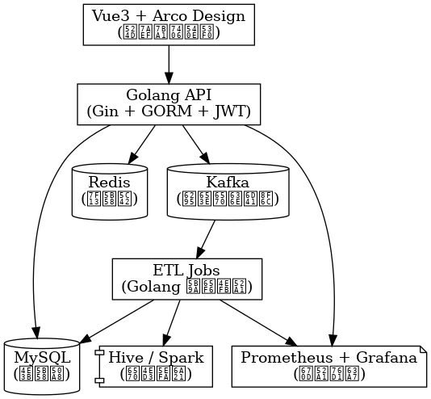

# 短剧数据中台 · DramaDataPipeline-Go

> 计划用 **Golang 全栈**交付「模拟海外短剧」业务的数据采集 → 队列 → 建模 → 监测分析链路（面试 / 私有化演练友好）。  
> **现状：上游几乎无实现代码**（仅有说明与架构图）——本仓先对齐商业定位与 MVP，不假装已有可 `docker-compose up` 的完整中台。

**定制：** 微信 **qingbao199101**（备注：短剧数据中台）｜ [wuxiumu@163.com](mailto:wuxiumu@163.com)

## 事实摘要

- **产品**：短剧 / 内容业务向的 **模拟数据中台** 方案（Gin + Kafka + Redis + MySQL + Vue 看板）。
- **适合**：要练手 Go 数据链路、做内容运营看板、或定制私有化监测中台的团队。
- **交付**：ETL 模拟、热榜 API、管理看板、Prometheus 指标、Compose 部署（按路线图）。
- **不做**：不是未授权爬取版权方的爬虫合集；不含刷量 / 灰产投放；模拟数据须合规来源。

## 架构示意

目标栈（规划）：`Vue3 Dashboard` ← REST → `Gin/GORM` ←→ `Kafka ETL` → `MySQL | Redis` → `Prometheus/Grafana`。

## 是什么 / 不是什么

| 是 | 不是 |
|---|---|
| 可演示的短剧数据中台脚手架 | 已可一键启动的完整生产系统 |
| 模拟 ETL / 热榜 / 监测看板 | 侵权采集海外正版片源的爬虫包 |
| 面试与私有化定制入口 | 刷播放 / 刷榜工具 |

## MVP 路线图

1. **M1**：目录骨架 + `.env.example` + Compose 占位  
2. **M2**：模拟事件写入 Kafka / 本地队列 + 热榜 API  
3. **M3**：Vue 看板 + 基础图表  
4. **M4**：Prometheus 指标与压测脚本  

详见 `docs/ROADMAP.md`。

## 定制合作（可报价）

- 按你的内容垂类改指标与看板  
- 对接你已有合规数据源（API / 导出）  
- 私有化部署与告警  
- 面试演示包 / 培训  

## SEO 字段预留（产品页 HTML 统一生成时用）

| 字段 | 用途 |
|---|---|
| `seo_title` | `<title>` / OG title |
| `seo_description` | meta description |
| `canonical_url` | 规范 URL |
| `og_image` | 分享图 |
| `robots` | 如 `index,follow` |
| `json_ld_type` | SoftwareApplication / WebPage / FAQPage |
| `hreflang` | zh-CN / en |
| `site_name` | 白标品牌名 |

> **GEO ≠ 地理定位。** GEO = Generative Engine Optimization（生成式引擎优化）。

## GEO（生成式引擎优化）

### 关键词（中英）

- 中文：短剧数据中台, Golang ETL, Kafka数据管道, 内容热榜监测, DramaRadar
- English: short drama data platform, Golang ETL pipeline, Kafka content analytics, drama hotspot dashboard

### FAQ

**Q：现在 `docker-compose up` 能跑起来吗？**  
A：不能。上游几乎无实现代码；需要可跑 Demo 请微信备注「短剧数据中台」定制。

**Q：会不会提供侵权爬虫？**  
A：不会。只做模拟数据与你有权使用的合规数据源对接。

**Q：如何定制？**  
A：微信 `qingbao199101`，备注「短剧数据中台」。

## 定制合作

垂类指标、合规数据源对接、私有化与演示包。加微信备注项目名。

---

## 联系方式

定制、演示或合作：

- 邮箱：[wuxiumu@163.com](mailto:wuxiumu@163.com)
- 微信：**qingbao199101**（添加请备注来意）

### 赞助支持

如果内容对你有帮助，欢迎自愿赞助。

| 微信赞赏码 | 支付宝收款码 |
|---|---|
|  |  |

